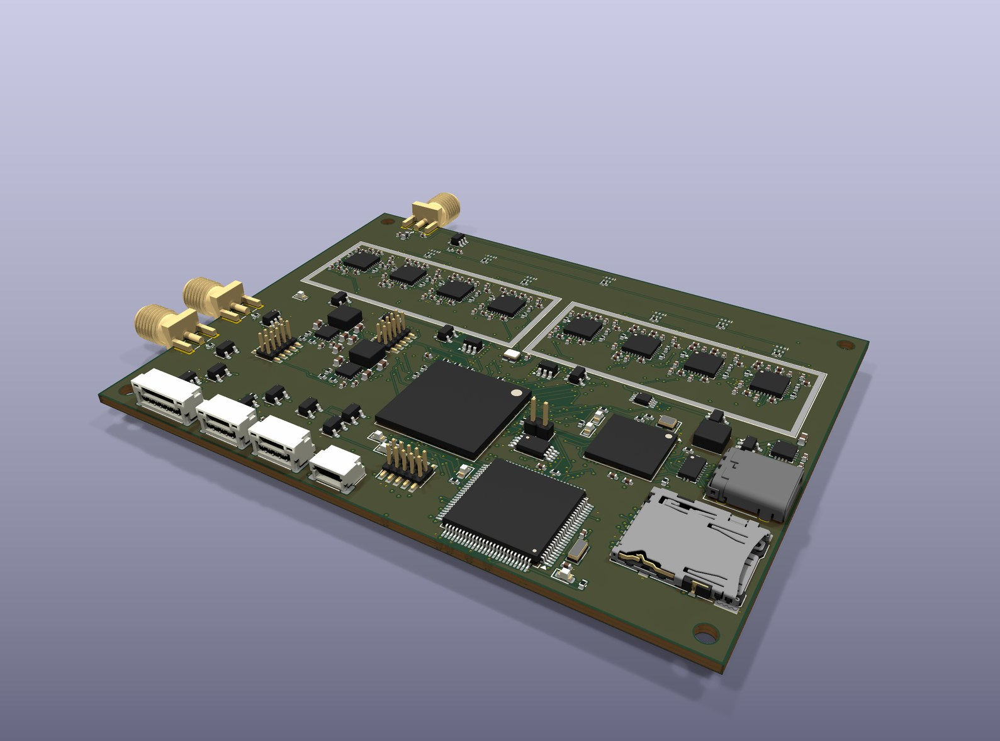
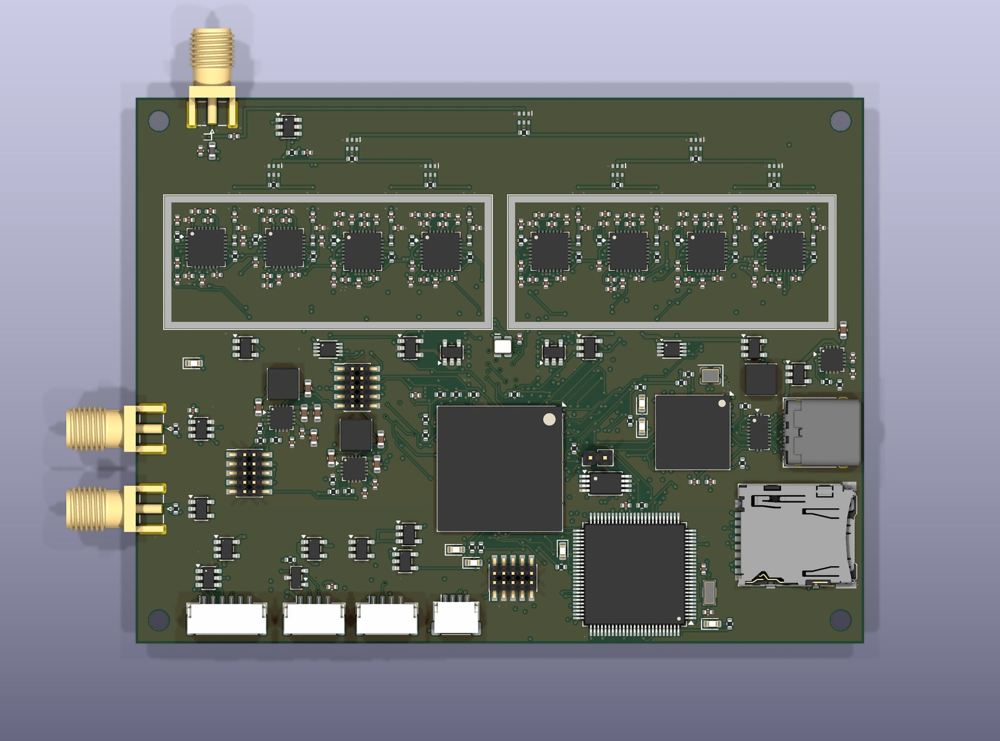
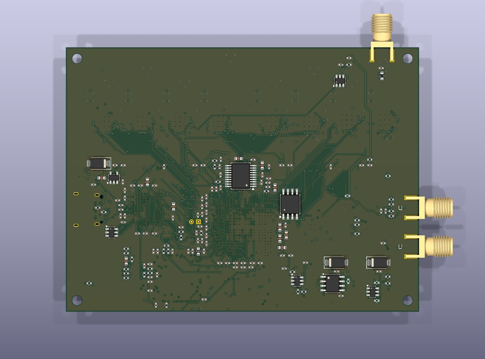
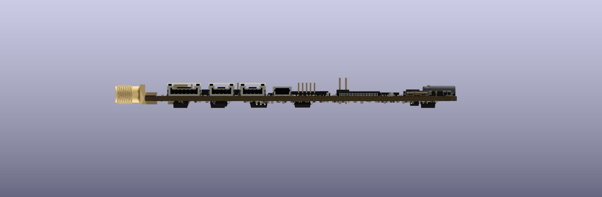

# Справка о состоянии работ по МГП-8 на 25.10.2026

Модуль приёмника ГНСС многочастотного МГП-8, ШИВА.468157.001. Разработчик —
ООО ШИВА НЕТВОРК. Исходные тексты — github.com/SiwaNetwork/DRON, каталог `gnss_receiver`.

## 1 Итог в двух словах

- Этап 1 «Эскизный проект» (ТЗ, п. 8) выполнен, комплект документов ЭП выпущен.
- Этап 2 «Технический проект» по содержанию выполнен:
  - печатная плата разведена полностью;
  - конфигурация ПЛИС собрана на целевом кристалле с запасом по частоте;
  - встроенное ПО МК собирается и проверено на моделях.
- Документы этапа 2 (ведомость ТП и рабочая КД на плату) **не выпущены**. Это главный
  разрыв перед изготовлением опытных образцов (этап 3).
- Всё проверено только на моделях и имитаторе. Опытного образца ещё нет.

## 2 Как выглядит изделие сейчас

3D-модель платы получена из файла платы `hw/kicad/mgp8.kicad_pcb` командой
`hw/gen/render3d.py`. Экраны показаны без крышек. Для ПЛИС, MAX2771 и ТКГ в библиотеке
KiCad нет 3D-моделей, поэтому вместо них показаны корпуса тех же размеров.

Размещение на плате:

- **Сверху:** антенный вход XW1, питание антенны с датчиком тока, делитель 1:8 (три яруса).
- **Две экранированные зоны:** по 4 приёмника MAX2771 в каждой.
- **В середине:** стабилизаторы каналов и опорный генератор 24 МГц.
- **Внизу:**
  - слева — питание, вход опоры 10 МГц XW2 и выход 1PPS XW3;
  - в центре — ПЛИС LFE5U-45F;
  - справа — FX3 (USB 3.0), USB-C и microSD;
  - у нижнего края — микроконтроллер STM32H743 и разъёмы X5…X8.

Таблица 1 — Основные параметры платы

| Параметр | Значение | Норма ТЗ |
|---|---|---|
| Размеры платы | 100 × 75 мм | ≤ 100 × 75 мм |
| Высота с экранами | 9,90 мм | ≤ 12 мм |
| Масса без корпуса | 55,9 г | ≤ 80 г |
| Слои, материал | 8 слоёв, FR-4 (Tg ≥ 170 °С), 1,6 мм, класс точности 5, ENIG | 8 слоёв, класс 5 |
| Посадочные места | 429 (включая 4 крепёжных отверстия) | — |
| Проводники | 9312 отрезков, 1311 переходов, 10,64 м | — |
| Проверка DRC (25.10.2026) | 0 нарушений, 0 неразведённых, 0 расхождений со схемой Э3 | — |
| Потребляемая мощность | 3,29 Вт (с выдачей отсчётов по USB 3.0) | ≤ 3,5 Вт |
| Температура кристаллов при +85 °С | ≤ 92,7 °С (при отводе тепла на крышку корпуса) | — |
| ПЛИС: частота / логика / память | 100,15 МГц / 81 % / 107 из 108 блоков EBR | ≥ 96 МГц |

## 3 Почему восемь приёмников MAX2771 на одну антенну

Схема с одним антенным входом и делителем 1:8 заложена в ТЗ с первой редакции
(п. 5.1.2, 08.10.2026). Восьми антенных разъёмов в документах проекта не было.

- **Один MAX2771 принимает один частотный диапазон.** У него один гетеродин и полоса ПЧ
  до 36 МГц. Сигналы ГНСС лежат в восьми диапазонах от 1176 до 1602 МГц (ТЗ, таблица 1):
  - L1/E1/B1;
  - ГЛОНАСС G1;
  - L2C;
  - ГЛОНАСС G2;
  - L5/E5a;
  - E5b/B2;
  - B3I;
  - E6.

  Чтобы принимать все системы на всех частотах одновременно, нужен приёмник на каждый
  диапазон.
- **Одной многодиапазонной антенны достаточно.** Все спутники видны через одну антенну.
  Делитель 1:8 теряет около 10,5 дБ, но их перекрывает усиление МШУ активной антенны
  (28 дБ). Коэффициент шума тракта — 2,15 дБ, то есть чувствительность практически
  не теряется (ПЗ 5.1).
- **Что это даёт:**
  - **Двухчастотные измерения.** Ионосферная задержка исключается, ошибка координат
    на модели — 0,5…0,6 м по четырём системам (ПЗ 5.4.6) против 11 м только по L1
    (ПЗ 5.4.4).
  - **Время.** То же исключение ионосферы нужно для 1PPS ≤ 5 нс.
  - **Больше спутников.** Четыре системы одновременно, что важно в городе и при
    затенении.
  - **Устойчивость к помехам.** Подавитель чаще всего глушит L1, а L2/L5/B3 продолжают
    работать. Кроме того, в каждом канале есть режекторный фильтр (до 50 дБ J/S).
  - **Задел на RTK** (фаза несущей на нескольких частотах) и **запись «сырых» отсчётов**
    по USB 3.0 в формате Pocket SDR.

  Для сравнения: u-blox ZED-F9T принимает две полосы, МГП-8 — восемь.
- **Когда нужны несколько антенн.** Несколько разъёмов нужны для антенной решётки
  (адаптивное подавление помех, CRPA) или для определения курса по двум антеннам. Это
  другая задача:
  - все каналы работают на одной частоте (например, 8 × L1), и многочастотность
    теряется;
  - нужна фазовая калибровка гетеродинов разных MAX2771;
  - нужны 8 антенн на носителе.

  Если такая задача стоит, её стоит рассматривать как отдельное исполнение. Например,
  два входа «4 + 4» для определения курса. Это решение владельца (см. раздел 6).

## 4 Что выполнено (по ТЗ, ПЗ разд. 7)

| Направление | Состояние |
|---|---|
| Схема Э3, перечни, ВП | выполнено, схема и плата совпадают |
| Печатная плата | разведена полностью, DRC без замечаний; тепловая модель и масса пересчитаны |
| ПЛИС | 80 каналов коррелятора, режекторные фильтры, шкала времени и 1PPS, ускоритель захвата на БПФ; всё сверено с битово-точными моделями |
| ПО МК: сигналы | GPS L1 C/A, ГЛОНАСС L1OF, Galileo E1-B, BeiDou B1I полностью; вторые частоты L2C/L5, G2, E5a, B3I и двухчастотный режим |
| ПО МК: обмен и загрузка | протоколы NMEA, RTCM и собственный; загрузчик и обновление ПО |
| Захват слабых сигналов | 29 дБГц: ускоритель ПЛИС в фоновом поиске, вероятность обнаружения за цикл ≈ 0,7 |
| Точность (на модели) | координаты 0,5…0,6 м (четыре системы, две частоты); 1PPS 3,6 нс (СКО), 1,2 нс с поправкой qErr |
| Не выполнено | режим синхронизации времени (survey-in, T-RAIM, удержание), калибровка задержек, метка EXTINT ≤ 8 нс, файловая система microSD, команды по CAN, BeiDou D2, Galileo F/NAV, RTK (второй этап ОКР) |

## 5 Комплект документов и соответствие ГОСТ

### 5.1 Что выпущено (каталог `kd/`)

Все документы выпущены в PDF (подлинник); там, где указано, есть и DOCX (редактируемая
копия). Основная надпись — «ООО ШИВА НЕТВОРК», литера «Э». Перед выпуском справки все
документы заново собраны из исходных текстов (25.10.2026). Текст и число листов совпали
с выпущенными, значит документы актуальны.

| Обозначение | Документ | Листов | ГОСТ | DOCX |
|---|---|---|---|---|
| ШИВА.468157.001 ТЗ | Техническое задание | 8 | ГОСТ 2.105, 2.106 | есть |
| ШИВА.468157.001 ЭП | Ведомость эскизного проекта | 1 | ГОСТ 2.106 | — |
| ШИВА.468157.001 | Спецификация | 9 | ГОСТ 2.106 | есть |
| ШИВА.468157.001 Э1 | Схема электрическая структурная | 1 | ГОСТ 2.701, 2.702 | — |
| ШИВА.468157.001 Э3 | Схема электрическая принципиальная | 11 | ГОСТ 2.701, 2.702, 2.710 | — |
| ШИВА.468157.001 ПЭ3 | Перечень элементов | 10 | ГОСТ 2.701 | есть |
| ШИВА.468157.001 ВП | Ведомость покупных изделий | 4 | ГОСТ 2.106 | есть |
| ШИВА.468157.001 ПЗ | Пояснительная записка | 23 | ГОСТ 2.106 | есть |
| ШИВА.468157.001 ПМ | Программа и методика испытаний | 8 | ГОСТ 2.106 | есть |
| ШИВА.00001-01 13 01 | Описание программы (ПО МК) | 10 | ГОСТ 19.402 | есть |

**Вывод по этапу 1.** Комплект ЭП соответствует ТЗ п. 7.1, кроме одного пункта: ТЗ требует
программные документы на конфигурацию ПЛИС, а такого документа нет. Устройство ПЛИС описано
только в ПЗ (разд. 4.4 и 6).

### 5.2 Чего не хватает для этапа 2 и изготовления опытного образца

По ТЗ п. 8 результат этапа 2 — «ТП, РКД на плату».

| Документ | ГОСТ | Зачем |
|---|---|---|
| Ведомость технического проекта (ТП), ПЗ с литерой «Т» | ГОСТ 2.102, 2.103, 2.106 | закрытие этапа 2 |
| Сборочный чертёж ШИВА.468157.001 СБ | ГОСТ 2.109 | монтаж; в спецификации его ещё нет |
| Чертёж печатной платы ШИВА.758726.001 | ГОСТ 2.417 | в спецификации стоит с пометкой «Этап 2»; содержит стек слоёв, материал, класс, покрытие, маркировку |
| Файлы для изготовления: Gerber, сверловка, координаты установки, BOM | ГОСТ 2.051 (электронные документы) | заказ платы и монтажа |
| Электронная модель изделия (3D) | ГОСТ 2.052 | нужны 3D-модели семи типов корпусов (ПЛИС, MAX2771, ТКГ, делители, экраны и др.) |
| Программные документы ПЛИС: описание и текст программы | ГОСТ 19.402, 19.401 | требование ТЗ п. 7.1 и 5.9.2 |
| Программные документы ПО МК: спецификация, текст программы, руководство программиста (протоколы обмена) | ГОСТ 19.202, 19.401, 19.504 | комплект ЕСПД; ТЗ п. 5.9.2 |

На этапах 3–4 понадобятся ещё:

- эксплуатационные документы опытного образца — паспорт или этикетка, руководство
  по эксплуатации (ГОСТ 2.601, 2.610);
- протоколы предварительных испытаний;
- корректировка КД и литера «О» (ГОСТ 2.103).

### 5.3 Замечания к плате до выпуска РКД

- **Нет маркировки.** На плате нет обозначения, поля для заводского номера и даты
  изготовления, хотя этого требует ТЗ п. 5.10.1.
- **Нет реперных знаков** для автоматического монтажа. Это критично для BGA с шагом 0,8 мм:
  нужны 2–3 знака на плату (или на технологические поля заготовки) и местные знаки у ПЛИС.
- **Последнюю доразводку повторить нельзя.** Её делали разовыми сценариями, поэтому
  эталон — сам файл платы. Перегенерация платы (`pcb.py place`) сотрёт разводку.

## 6 Рекомендации: что делаем дальше

Очерёдность предлагается по критическому пути к опытному образцу.

1. **Подготовить плату к заказу (1–2 недели).**
   - Добавить маркировку и реперные знаки.
   - Согласовать стек слоёв и импеданс 50 Ом с изготовителем.
   - Отдать плату на проверку технологичности изготовителю: класс 5, переходы 0,4/0,2 мм,
     8 слоёв.
   - Провести независимую проверку схемы и платы инженером (ВЧ-тракт, питание, отводы
     BGA).
2. **Выпустить РКД на плату и документы этапа 2:**
   - чертёж платы, СБ, спецификацию с СБ и платой;
   - файлы для изготовления;
   - ведомость ТП, ПЗ с литерой «Т»;
   - программные документы ПЛИС и ПО МК (раздел 5.2).
3. **Начать закупку ЭКБ сразу**, не дожидаясь документов. Позиции с длинными сроками
   поставки: MAX2771, LFE5U-45F, CYUSB3014, STM32H743. Объём — на 5 образцов (ТЗ п. 8)
   с запасом. Отдельно заказать технологический корпус с выступами крышки над ПЛИС,
   МК и FX3 для отвода тепла.
4. **Пока плата в производстве — ПО и стенд:**
   - режим синхронизации времени (survey-in, фиксированные координаты, T-RAIM,
     удержание 1PPS) — главный пробел по ТЗ п. 5.2.13 и сравнению с ZED-F9T;
   - метка EXTINT с дискретностью 5,2 нс в ПЛИС;
   - файловая система microSD;
   - команды по CAN;
   - стенд по ПМ: имитатор сигналов, измеритель временных интервалов, ZED-F9T для
     сравнения.
5. **Запуск опытного образца (этап 3)** по шагам:
   - питание → тактирование → загрузка ПЛИС → шина FMC → настройка MAX2771;
   - запись отсчётов через FX3 и проверка в Pocket SDR;
   - слежение → навигационное решение.

   Перед первым включением сверить адреса регистров МК с RM0433: они набраны вручную.
6. **Предварительные испытания (этап 4)** по ПМ:
   - имитатор, натурные испытания, борт БАС;
   - тепловые испытания при +85 °С;
   - корректировка КД, литера «О».
7. **Решения владельца:**
   - нужна ли многоантенная версия (курс по двум антеннам или антенная решётка — раздел 3);
   - сроки и состав импортозамещения ЭКБ (ПЗ разд. 8);
   - RTK и дифференциальный режим 1PPS — на втором этапе ОКР, как в ТЗ.

## 7 Риски

- **Проверка только на моделях.** Ошибки разводки, ВЧ-согласования и регистров МК
  проявятся только на образце.
- **Ресурсов почти не осталось:**
  - ПЛИС: блоки памяти 107 из 108, логика 81 %;
  - ОЗУ МК: DTCM 99,8 %, D2 97 %.

  Новые функции (длительное накопление, ускоритель для E1/B1I) потребуют переноса
  обработки или более ёмкой ПЛИС.
- **Мы уступаем ZED-F9T** по чувствительности и времени первого решения. Это честно
  указано в ТЗ, таблица 2; сравнение — на испытаниях.
- **Вся ЭКБ иностранная.** Направления замены — ПЗ разд. 8.
